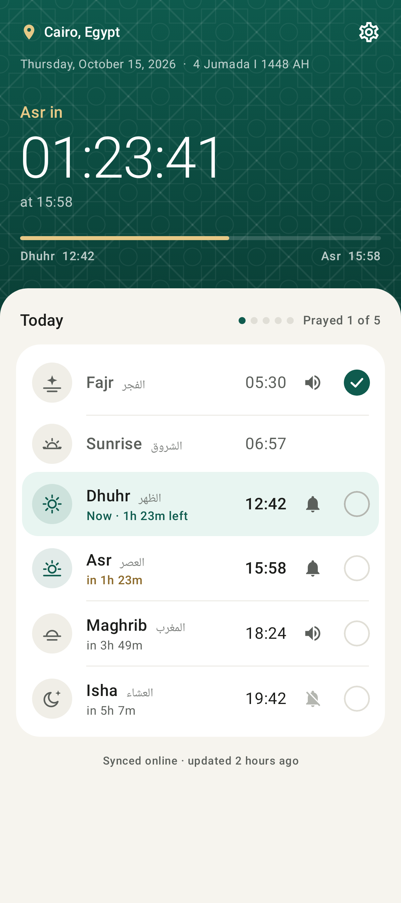
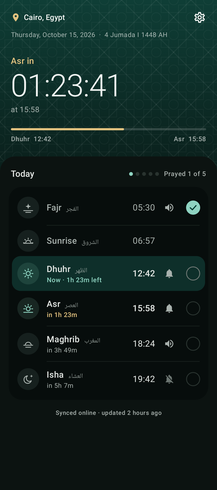
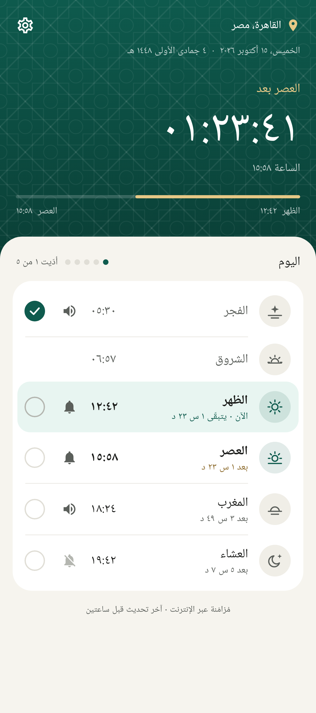
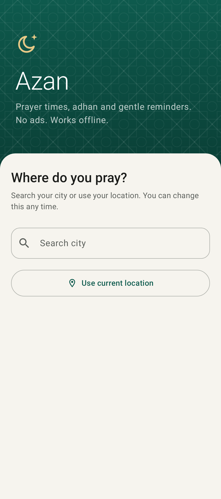

# Azan

A small, ad-free Android prayer-times app.

<p>
  
  
  
  
</p>

- **No ads, no tracking.** The app has no ads or analytics SDKs. It only goes online to download prayer times.
- **Accurate, and it works offline.** When internet is available, the app downloads this month's and next month's times from [aladhan.com](https://aladhan.com/prayer-times-api) for your location and method. They're cached on the phone, so it keeps working offline for weeks. If it has never synced, or the cache runs out, the times are calculated on the device, and the main screen shows which source is in use. Downloaded times are checked against the on-device calculation, and any day that disagrees by more than an hour is thrown away.
- **Per-prayer ± minute adjustments,** to match your local mosque exactly.
- **Choose what happens at each prayer:** *Off*, *Notify* (a notification with sound), or *Adhan* (the full adhan plays, with a **Stop** button in the notification). Set this for each prayer in Settings, or tap the bell icon next to a prayer on the main screen.
- **Time remaining:** a live countdown to the next prayer, plus "in 2h 15m" / "Now" / "Passed" next to each prayer.
- **"Have you prayed?" reminder:** before the next adhan (20 minutes by default; you can pick 10–45), you get a notification asking whether you've prayed the current prayer. It has **Yes, I prayed** and **Not yet** buttons. For Fajr, the reminder comes before sunrise, because that's when Fajr ends. If you've already ticked the prayer as prayed, by tapping the checkbox on the main screen or a notification button, there's no reminder.
- **Offline city search:** type a city in English or Arabic, e.g. "Cairo" or "القاهرة". The list has 34,000 cities with 15,000+ people, from [GeoNames](https://www.geonames.org) (CC BY 4.0). Picking a city also sets the usual calculation method for its country. You can still use GPS or type coordinates.
- **Arabic and English.** The whole app is translated, with right-to-left layout and Arabic digits. It follows the phone's language, or you can switch in **Settings → Language**.
- Shows the Hijri date. Supports 20 calculation methods, including Egyptian, MWL, Umm al-Qura, ISNA, Moonsighting Committee, Karachi, the Gulf states, Turkey, Morocco, Algeria, Tunisia, Jordan, Malaysia, Indonesia, France and Russia. Asr can be Standard or Hanafi. High latitudes are adjusted too.

## Adhan sound

Under **Settings → At prayer time → Adhan sound** you can choose:

- **A built-in voice.** These are freely licensed recordings from Wikimedia Commons. Each one is downloaded once, then kept on the phone so it plays offline:
  - [Beautiful Adhan](https://commons.wikimedia.org/wiki/File:Beautiful_adhan.ogg) by Adam-synagda (CC0)
  - [Adhan](https://commons.wikimedia.org/wiki/File:Azan.ogg) by Andrewler (CC BY-SA 4.0)
  - [The Adhan, Aaqib Azeez](https://commons.wikimedia.org/wiki/File:The_Adhan_-_Muslim_Call_to_Prayer_-_Aaqib_Azeez.mp3) by Atcovi (CC BY-SA 4.0)
  - [Short adhan](https://commons.wikimedia.org/wiki/File:Adhan.ogg) by Aishatu98 (CC0)
- **My own file.** Famous recordings, such as Makkah, Madinah or well-known muezzins, are copyrighted and can't be shipped with the app. Save one you like to your phone and pick it here.
- **The phone's alarm sound.**

Tap **Test** to hear the current choice.

## Install

Every push builds a debug APK on GitHub Actions. Open the **Actions** tab, select the latest run, and download the `azan-debug-apk` artifact. Unzip it and install `app-debug.apk` on the phone. You'll need to allow installing from unknown sources.

To build it yourself, use JDK 17+ and the Android SDK:

```
./gradlew assembleDebug        # app/build/outputs/apk/debug/app-debug.apk
./gradlew testDebugUnitTest    # prayer time + scheduling tests
./gradlew testDebugUnitTest -Pscreenshots=true --tests '*ScreenshotTest*'   # re-render docs/screenshots
```

## Google Play

See [PLAY_STORE.md](PLAY_STORE.md). The app targets API 36. Signed bundles are built by the **Release (Google Play)** workflow when you push a `v*` tag, and the store listing and graphics are in `fastlane/metadata/android/`.

## First run

1. Allow notifications.
2. Set your location: tap **Use current location**, or type in the latitude and longitude.
3. On Android 12+, tap **Allow** on the "Alarms & reminders" banner so the adhan plays on time.
4. If adhans come late on your phone, go to **Settings → Battery settings** and turn off battery optimization for Azan.

## Code layout

| Path | What |
| --- | --- |
| `prayer/PrayerCalculator.kt` | Astronomical prayer time calculation (PrayTimes algorithm). Tested against the `adhan` library. |
| `prayer/PrayerSchedule.kt` | Pure logic for the next adhan, the next reminder, the current prayer, and the next prayer. |
| `alarm/` | Exact alarms (`AlarmScheduler`), alarm/boot receivers, notifications, and the foreground `AdhanService` that plays the adhan. |
| `sync/` | Aladhan API client, offline cache, and the WorkManager job that syncs whenever the phone is online. |
| `prayer/PrayerTimesSource.kt` | Picks synced or calculated times, applies adjustments, and validates downloaded data. |
| `location/` | Offline city search over `assets/cities.tsv`, built by `tools/build_cities.py`. |
| `audio/AdhanVoices.kt` | Built-in voice catalogue and downloader. |
| `data/SettingsStore.kt` | Settings and "prayed" flags (SharedPreferences). |
| `ui/` | Jetpack Compose screens. |
